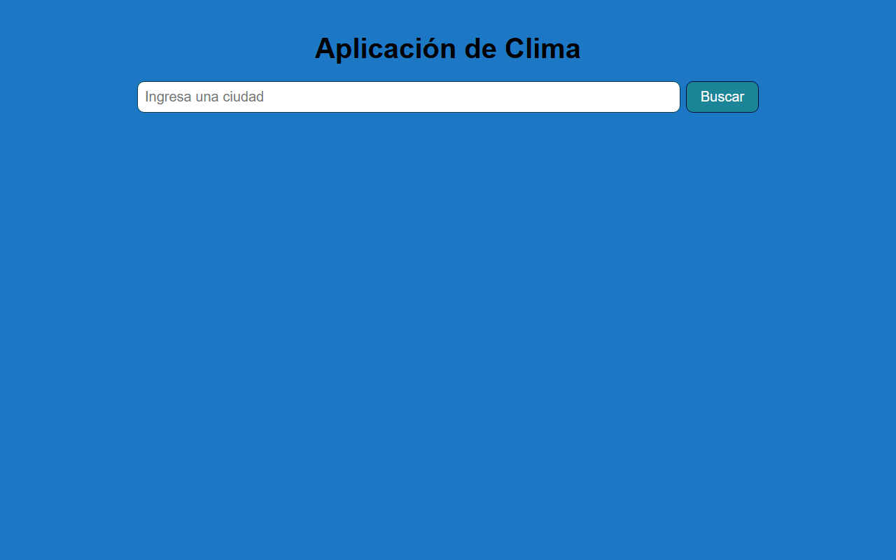

# Aplicación de Clima · React

Buscador de clima en español: escribís una ciudad y la app muestra la temperatura actual, la condición meteorológica y el ícono del tiempo usando la API de OpenWeatherMap.

Proyecto de práctica construido con **React 19 + Vite** y estilos CSS propios.


## Contenido

- [Capturas](#capturas)
- [Características](#características)
- [Stack](#stack)
- [Estructura del repositorio](#estructura-del-repositorio)
- [Requisitos](#requisitos)
- [Puesta en marcha](#puesta-en-marcha)
- [Configuración](#configuración)
- [Despliegue](#despliegue)

## Capturas

| Buscador |
| :------: |
|  |

## Características

- Búsqueda por nombre de ciudad con el formulario **Buscar**.
- Respuesta en español (`lang=es`) de OpenWeatherMap.
- Temperatura convertida de Kelvin a grados Celsius.
- Descripción del estado del tiempo e ícono oficial `@2x`.
- Interfaz responsive con CSS propio, sin frameworks de estilos.

## Stack

| Capa | Tecnologías |
| --- | --- |
| Frontend | React 19 · React DOM 19 · JavaScript (ESM) |
| Build | Vite 7 (paquete `rolldown-vite`) |
| Estilos | CSS3 nativo (`WeatherApp.css`, `style.css`) |
| Calidad | ESLint 9 con `eslint-plugin-react-hooks` y `eslint-plugin-react-refresh` |

## Estructura del repositorio

```text
aplicacion-clima-react/
├── src/
│   ├── main.jsx           # Punto de entrada de React
│   ├── WeatherApp.jsx     # Formulario, fetch y render del clima
│   ├── WeatherApp.css
│   └── style.css
├── index.html
├── vite.config.js
├── eslint.config.js
└── package.json
```

## Requisitos

- Node.js 18 o superior y npm.
- Una API key de [OpenWeatherMap](https://openweathermap.org/api) (ya viene una de prueba en el código).

## Puesta en marcha

```bash
npm install
npm run dev
```

Abrí <http://localhost:5173>, escribí una ciudad (por ejemplo `Buenos Aires`) y tocá **Buscar**.

```bash
npm run lint    # ESLint
npm run build   # build de producción en dist/
npm run preview # sirve el build localmente
```

## Configuración

La API key y la URL base están al inicio de `src/WeatherApp.jsx`:

```js
const urlBase = 'https://api.openweathermap.org/data/2.5/weather'
const API_KEY = 'tu-api-key'
```

Para un proyecto público, conviene moverla a una variable de entorno (`VITE_WEATHER_API_KEY`) y leerla con `import.meta.env`. La key incluida en el repo es de uso libre y tiene límites de requests.

## Despliegue

El build es estático: publicá la carpeta `dist/` en Netlify, Vercel, Cloudflare Pages o GitHub Pages. En Netlify/Vercel usá `npm run build` como comando y `dist` como directorio de salida.
